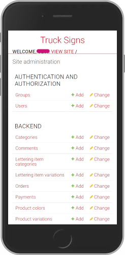
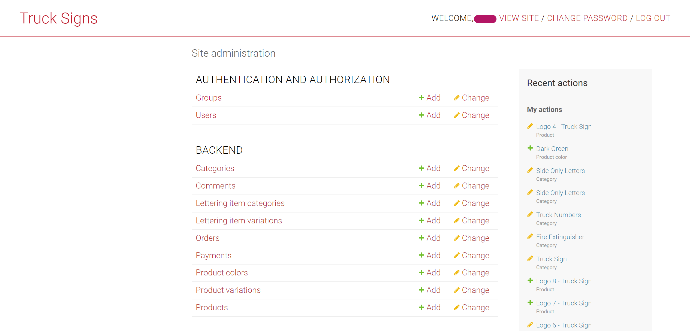
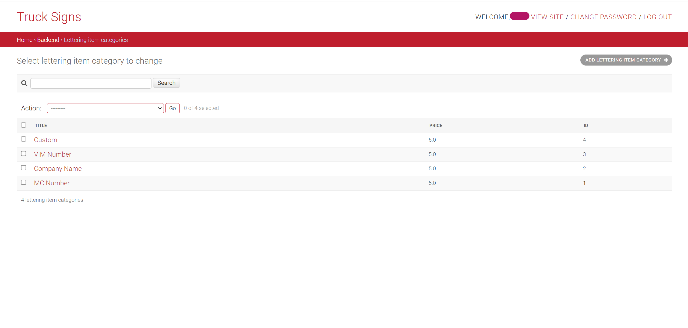

<div align="center">

# Signs for Trucks

  


__Signs for Trucks__ is an online store to buy pre-designed vinyls with custom lines of letters (often call truck letterings).
The store also allows clients to upload their own designs and to customize them on the website as well.

</div>

## Table of Contents

- [About this Repository](#about-this-repository)
- [Prerequisites](#prerequisites)
- [Quickstart](#quickstart)
  - [How to Build the Image](#how-to-build-the-image)
- [Access](#access)
- [Usage](#usage)
  - [Files](#files)
  - [Configuration](#configuration)
  - [Run with docker run](#run-with-docker-run)
  - [Verify](#verify)
  - [Stop and Cleanup](#stop-and-cleanup)
  - [Local Development without Docker](#local-development-without-docker)
  - [Testing](#testing)
  - [Models](#models)
  - [Brief Explanation of the Views](#brief-explanation-of-the-views)
- [Screenshots of the Django Backend Admin Panel](#screenshots-of-the-django-backend-admin-panel)
  - [Mobile View](#mobile-view)
  - [Desktop View](#desktop-view)
- [Additional Information](#additional-information)
  - [Postgresql Database](#postgresql-database)
  - [Docker](#docker)
  - [Django and DRF](#django-and-drf)
  - [Miscellaneous](#miscellaneous)

## About this Repository

This repository contains the Django REST API backend of the Signs for Trucks store,
packaged for deployment with Docker:

- The `Dockerfile` builds an image that runs the API with Gunicorn.
- `docker-compose.yml` starts the API together with a PostgreSQL database.
- `entrypoint.sh` waits for the database, runs the migrations, creates a superuser
  and starts Gunicorn.
- A GitHub Actions workflow builds the image and publishes it to the GitHub Container
  Registry (`ghcr.io/durnama/truck-signs`).

The API is served on port `8020` of the host by default (configurable with `APP_PORT`).

## Prerequisites

- [Git](https://git-scm.com/install/), check with: `git --version`
- [Docker Engine](https://docs.docker.com/engine/install/) with the Compose plugin, check with:
  `docker --version` and `docker compose version`

For local development without Docker you need
[Python 3.12](https://www.python.org/downloads/release/python-3120/) instead.

## Quickstart

1. Clone the repo:

    ```bash
    git clone git@github.com:DurnaMa/truck-signs.git
    cd truck-signs
    ```

2. Create the `.env` file from the template and fill in the values
   (see [Configuration](#configuration)):

    ```bash
    cp example.env .env
    ```

3. Build the image (see [How to Build the Image](#how-to-build-the-image)) or pull it
   from the registry:

    ```bash
    docker compose pull
    ```

4. Start the containers:

    ```bash
    docker compose up -d
    ```

5. Open `http://<SERVER_IP>:8020/admin/` and log in with `SUPER_USER_NAME` and
   `SUPER_USER_PASSWORD`.

### How to Build the Image

`docker-compose.yml` does not build the image, it uses
`ghcr.io/durnama/truck-signs:${IMAGE_TAG:-latest}`. There are two ways to provide it.

**Build locally** from the project root:

```bash
docker build -t ghcr.io/durnama/truck-signs:latest .
```

**Build in CI**: pushing a Git tag triggers `.github/workflows/build.yaml`, which builds
the image and pushes it as `:latest` and as `:<tag>`:

```bash
git tag v1.0.0
git push origin v1.0.0
```

Set `IMAGE_TAG=v1.0.0` in `.env` to run a specific version instead of `latest`.

> [!NOTE]
> Packages on `ghcr.io` are private by default. Either make the package public in the
> GitHub package settings, or log in on the server before pulling:
> `docker login ghcr.io` with a personal access token that has the `read:packages` scope.

## Access

| Service | URL |
| --- | --- |
| API | `http://<SERVER_IP>:8020/` |
| Django admin | `http://<SERVER_IP>:8020/admin/` |

The database is only reachable inside the Docker network `tsa-network` and is not
published to the host.

> [!IMPORTANT]
> The host name or IP you use in the browser must be listed in `ALLOWED_HOSTS`.
> Otherwise Django answers every request with `400 Bad Request`.

> [!NOTE]
> The API is served over plain HTTP. There is no TLS termination in this setup.

## Usage

### Files

| File | Purpose |
| --- | --- |
| `README.md` | This documentation |
| `Dockerfile` | Builds the application image based on `python:3.12`, installs `netcat-openbsd` and the Python dependencies |
| `docker-compose.yml` | Defines the `db` (PostgreSQL) and `backend` (API) services, the network `tsa-network` and the volumes `postgres_data`, `static_data` and `media_data` |
| `entrypoint.sh` | Container entrypoint: waits for the database, runs `collectstatic` and `migrate`, creates the superuser if missing, starts Gunicorn |
| `example.env` | Template for the `.env` file with all configuration variables |
| `.dockerignore` | Files excluded from the Docker build context (e.g. `.env`, `.git/`, screenshots, docs) |
| `.gitignore` | Files excluded from version control (e.g. `.env`) |
| `requirements.txt` | Python dependencies |
| `pyproject.toml` | Configuration for the code quality tools `black`, `isort` and `flake8` |
| `docs/testing.md` | Description of the linters, formatter and tests |
| `.github/workflows/test.yaml` | CI: lints the code and runs the Django tests on pushes and pull requests to `main` |
| `.github/workflows/build.yaml` | CI: builds the image and pushes it to `ghcr.io` when a Git tag is pushed |
| `.github/workflows/check-open-pr.yaml` | CI: fails if a pushed feature branch has no open pull request |
| `src/` | Django project: `manage.py`, settings (`tsa_app`), the store app (`tsa_products`), templates and screenshots |

### Configuration

All values are read from the `.env` file in the project root. `example.env` lists every
key; remove the leading `#` of the lines you need.

| Variable | Purpose | Default |
| --- | --- | --- |
| `SECRET_KEY` | Django secret key, required | |
| `ALLOWED_HOSTS` | Comma-separated host names or IPs the API answers to, e.g. the server IP | |
| `DB_NAME` | Name of the PostgreSQL database | |
| `DB_USER` | PostgreSQL user | |
| `DB_PASSWORD` | PostgreSQL password, required in `MODE=prod` | |
| `DB_HOST` | Database host. Ignored by Docker Compose, which always uses `tsa_db` | |
| `DB_PORT` | Database port | `5432` |
| `POSTGRES_DB` | Database created by the `db` container, must match `DB_NAME` | |
| `POSTGRES_USER` | User created by the `db` container, must match `DB_USER` | |
| `POSTGRES_PASSWORD` | Password of that user, must match `DB_PASSWORD` | |
| `SUPER_USER_NAME` | User name of the Django superuser created on first start | |
| `SUPER_USER_EMAIL` | E-mail of that superuser | |
| `SUPER_USER_PASSWORD` | Password of that superuser | |
| `IMAGE_TAG` | Image tag used by `docker-compose.yml` | `latest` |
| `APP_PORT` | Host port the API is published on by `docker-compose.yml` | `8020` |
| `MODE` | `prod` uses PostgreSQL, `dev` or unset uses SQLite at `src/db.sqlite3`. Docker Compose always sets `prod` | |
| `DEBUG_ENABLED` | Enables Django debug mode. Docker Compose always sets `False` | `False` |
| `CLOUD_NAME`, `CLOUD_API_KEY`, `CLOUD_API_SECRET` | Cloudinary credentials for media uploads. Only used if `CLOUD_NAME` is set. Not passed to the container by Docker Compose | |
| `EMAIL_HOST_USER`, `EMAIL_HOST_PASSWORD` | Credentials for order e-mails. Sending is currently disabled, see the create order view in `views.py`. Not passed to the container by Docker Compose | |

> [!IMPORTANT]
> The `POSTGRES_*` values create the database on the first start of the `db` container.
> If they differ from the `DB_*` values, the API cannot connect. Changing them later
> has no effect on an existing `postgres_data` volume.

The superuser is created only if no user with `SUPER_USER_NAME` exists. Restarting the
containers does not change or overwrite an existing user.

To generate a new `SECRET_KEY`, see this
[Stackoverflow answer](https://stackoverflow.com/questions/41298963/is-there-a-function-for-generating-settings-secret-key-in-django).

### Run with docker run

Without Docker Compose, the same setup can be started with plain `docker` commands.
Replace the placeholders in `<...>` with your values.

```bash
docker network create tsa-network

docker run -d \
  --name tsa_db \
  --network tsa-network \
  --restart unless-stopped \
  -e POSTGRES_DB=<DB_NAME> \
  -e POSTGRES_USER=<DB_USER> \
  -e POSTGRES_PASSWORD=<DB_PASSWORD> \
  -v postgres_data:/var/lib/postgresql \
  postgres:18.6-alpine

docker run -d \
  --name tsa_backend \
  --network tsa-network \
  --restart unless-stopped \
  -p 8020:8000 \
  -e MODE=prod \
  -e DEBUG_ENABLED=False \
  -e SECRET_KEY=<SECRET_KEY> \
  -e ALLOWED_HOSTS=<SERVER_IP> \
  -e DB_NAME=<DB_NAME> \
  -e DB_USER=<DB_USER> \
  -e DB_PASSWORD=<DB_PASSWORD> \
  -e DB_HOST=tsa_db \
  -e DB_PORT=5432 \
  -e SUPER_USER_NAME=<SUPER_USER_NAME> \
  -e SUPER_USER_EMAIL=<SUPER_USER_EMAIL> \
  -e SUPER_USER_PASSWORD=<SUPER_USER_PASSWORD> \
  -v static_data:/app/src/staticfiles \
  -v media_data:/app/src/mediafiles \
  ghcr.io/durnama/truck-signs:latest
```

> [!NOTE]
> Values passed with `-e` end up in your shell history. To avoid that, put them into
> a file and pass it with `--env-file <file>` instead.

### Verify

1. Both containers are running and the database is healthy:

    ```bash
    docker compose ps
    ```

2. The entrypoint finished and Gunicorn is listening:

    ```bash
    docker compose logs backend
    ```

    The log shows `Superuser created successfully.` on the first start or
    `Superuser already exists` afterwards, followed by `Listening at: http://0.0.0.0:8000`.

3. The admin login page answers with `200`:

    ```bash
    curl -s -o /dev/null -w "%{http_code}\n" http://<SERVER_IP>:8020/admin/login/
    ```

### Stop and Cleanup

Stop and remove the containers. The database and uploaded media stay in their volumes
and are available again after the next `docker compose up -d`:

```bash
docker compose down
```

> [!WARNING]
> The `-v` flag also deletes the volumes `postgres_data`, `static_data` and `media_data`.
> All database content, including the superuser, and all uploaded media are lost.
>
> ```bash
> docker compose down -v
> ```

### Local Development without Docker

1. Create and activate a virtual environment:

    ```bash
    python -m venv venv
    source venv/bin/activate      # Linux/macOS
    venv\Scripts\activate         # Windows
    ```

2. Install the requirements:

    ```bash
    pip install -r requirements.txt
    ```

3. Create the `.env` file and set at least `SECRET_KEY`:

    ```bash
    cp example.env .env
    ```

    With `MODE` unset or `MODE=dev`, the app uses SQLite at `src/db.sqlite3` and needs
    no database variables. With `MODE=prod` it connects to PostgreSQL using
    `DB_NAME`, `DB_USER`, `DB_PASSWORD`, `DB_HOST` and `DB_PORT`.

4. Run the migrations:

    ```bash
    python src/manage.py makemigrations
    python src/manage.py migrate
    ```

5. Collect static files:

    ```bash
    python src/manage.py collectstatic
    ```

6. (Optional) Create a superuser:

    ```bash
    python src/manage.py createsuperuser
    ```

7. Start the development server:

    ```bash
    python src/manage.py runserver
    ```

The app is now running at [localhost:8000](http://localhost:8000).

> [!NOTE]
> To create Truck vinyls with Truck logos in them, first create the __Category__ Truck Sign,
> and then the __Product__ (can have any name). This is to make sure the frontend retrieves
> the Truck vinyls for display in the Product Grid as it only fetches the products of the
> category Truck Sign.

### Testing

Linters, formatter and tests are described in [`docs/testing.md`](docs/testing.md).

### Models

Most of the models do what can be inferred from their name. The following dots are notes about some of the models to make clearer their propose:
- __Category Model:__ The category of the vinyls in the store. It contains the title of the category as well as the basic properties shared among products that belong to a same category. For example, _Truck Logo_ is a category for all vinyls that has a logo of a truck plus some lines of letterings (note that the vinyls are instances of the model _Product_). Another category is _Fire Extinguisher_, that is for all vinyls that has a logo of a fire extinguisher.
- __Lettering Item Category:__ This is the category of the lettering, for example: _Company Name_, _VIM NUMBER_, ... Each has a different pricing.
- __Lettering Item Variations:__ This contains a foreign key to the __Lettering Item Category__ and the text added by the client.
- __Product Variation:__ This model has the original product as a foreign key, plus the lettering lines (instances of the __Lettering Item Variations__ model) added by the client.

### Brief Explanation of the Views

Most of the views are CBV imported from _rest_framework.generics_, and they allow the backend api to do the basic CRUD operations expected, and so they inherit from the _ListAPIView_, _CreateAPIView_, _RetrieveAPIView_, ..., and so on.

The behavior of some of the views had to be modified to address functionalities such as creation of order and payment, as in this case, for example, both functionalities are implemented in the same view, and so a _GenericAPIView_ was the view from which it inherits. Another example of this is the _UploadCustomerImage_ View that takes the vinyl template uploaded by the clients and creates a new product based on it.

---

## Screenshots of the Django Backend Admin Panel

### Mobile View

<div style="padding: 0 5rem; width: 100%;  display: flex; gap: 5rem; justify-content: center; flex-wrap: wrap;">




</div>

### Desktop View


<div style="padding: 0 5rem; width: 100%; display: flex; flex-direction: column; gap: 2rem; align-items: center; justify-content: center;">






</div>

## Additional Information

### Postgresql Database

- Setup Database: [Digital Ocean Link for Django Deployment on VPS](https://www.digitalocean.com/community/tutorials/how-to-set-up-django-with-postgres-nginx-and-gunicorn-on-ubuntu-16-04)

### Docker

- [Docker Official Documentation](https://docs.docker.com/)
- Dockerizing Django, PostgreSQL, Gunicorn, and Nginx:
    - Github repo of sunilale0: [Link](https://github.com/sunilale0/django-postgresql-gunicorn-nginx-dockerized/blob/master/README.md#nginx)
    - Michael Herman article on testdriven.io: [Link](https://testdriven.io/blog/dockerizing-django-with-postgres-gunicorn-and-nginx/)

### Django and DRF

- [Django Official Documentation](https://docs.djangoproject.com/en/5.2/)
- Generate a new secret key: [Stackoverflow Link](https://stackoverflow.com/questions/41298963/is-there-a-function-for-generating-settings-secret-key-in-django)
- Modify the Django Admin:
    - Small modifications (add searching, columns, ...): [Link](https://realpython.com/customize-django-admin-python/)
    - Modify Templates and css: [Link from Medium](https://medium.com/@brianmayrose/django-step-9-180d04a4152c)
- [Django Rest Framework Official Documentation](https://www.django-rest-framework.org/)
- More about Nested Serializers: [Stackoverflow Link](https://stackoverflow.com/questions/51182823/django-rest-framework-nested-serializers)
- More about GenericViews: [Testdriver.io Link](https://testdriven.io/blog/drf-views-part-2/)

### Miscellaneous

- Create Virtual Environment with Virtualenv and Virtualenvwrapper: [Link](https://docs.python-guide.org/dev/virtualenvs/)
- [Configure CORS](https://www.stackhawk.com/blog/django-cors-guide/)
- [Setup Django with Cloudinary](https://cloudinary.com/documentation/django_integration)
